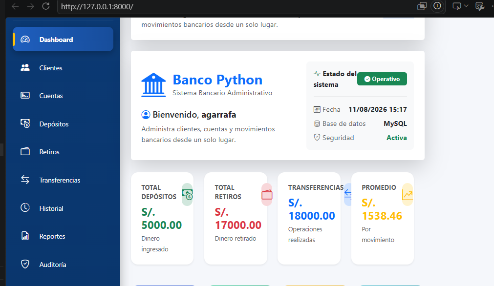
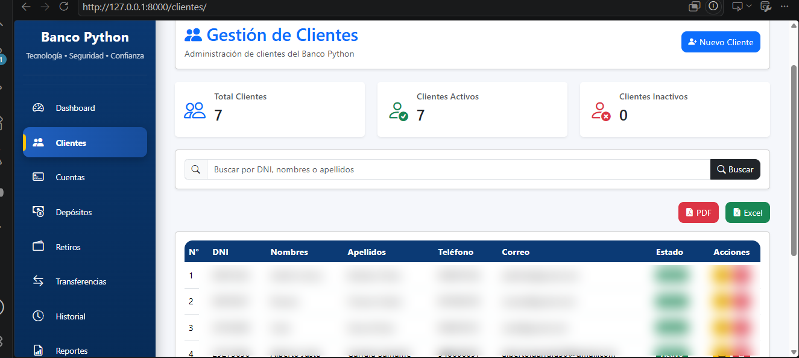
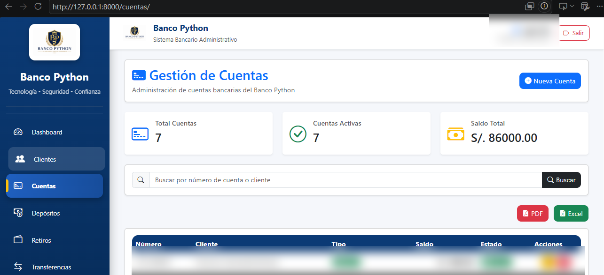
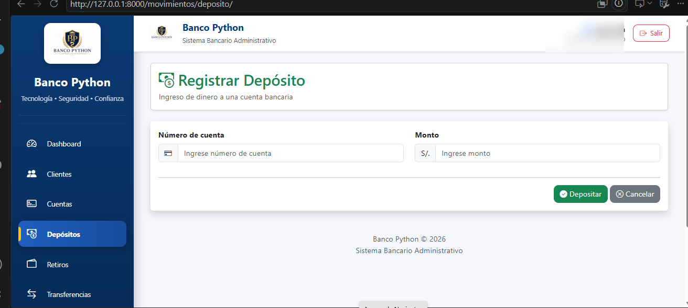
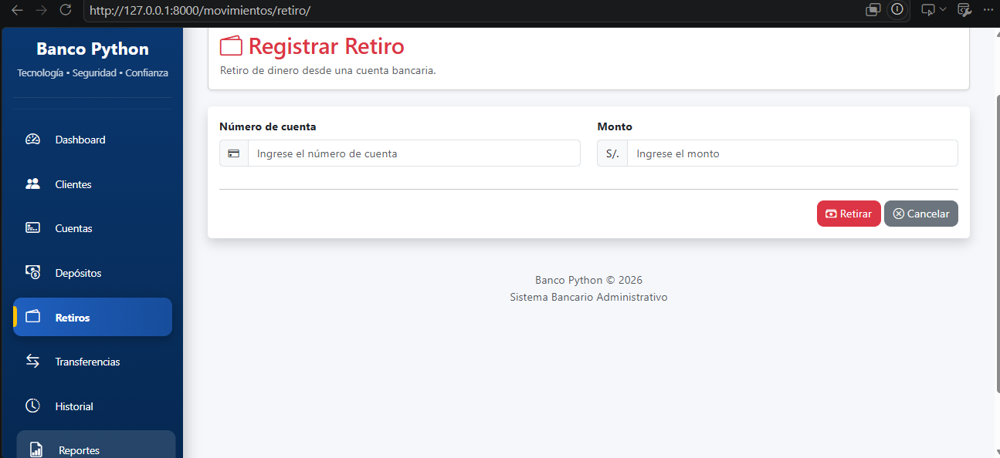
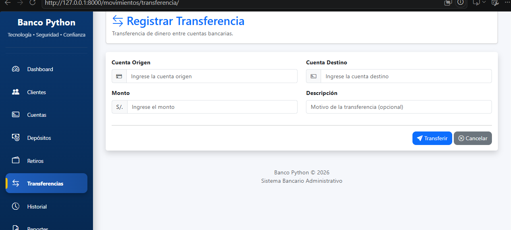
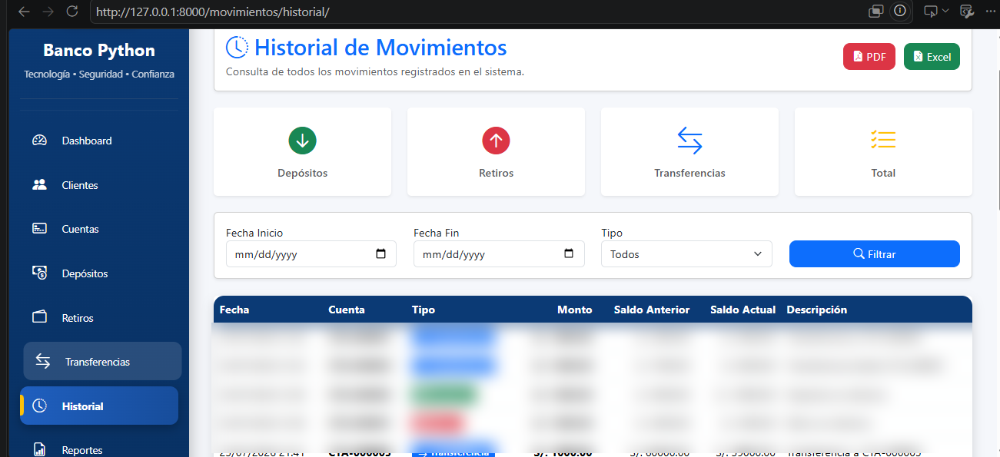
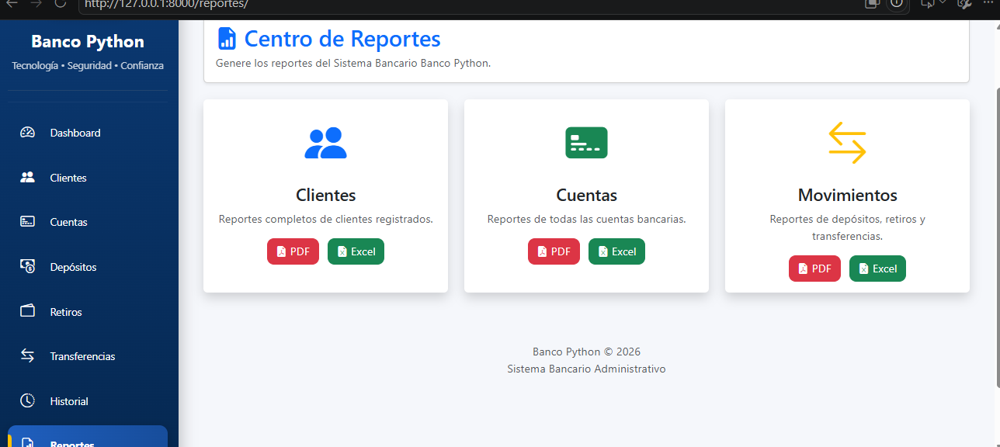
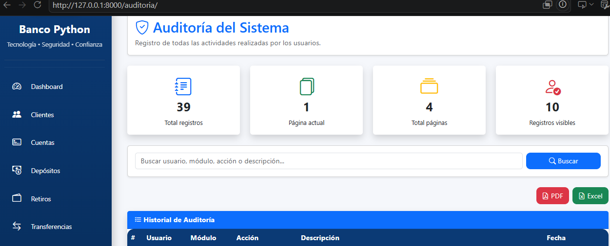

# Sistema Bancario

Aplicación web desarrollada con **Python y Django** para la administración de clientes, cuentas bancarias y operaciones financieras. Incluye control de movimientos, reportes, auditoría y medidas de seguridad.

> **Proyecto demostrativo de portafolio.** No está diseñado ni certificado para administrar dinero real ni para operar como una entidad financiera.

## Descripción

El Sistema Bancario permite gestionar las operaciones habituales de una aplicación bancaria de demostración desde una interfaz web.

El proyecto fue desarrollado utilizando Django y una arquitectura organizada por aplicaciones para separar las responsabilidades de cada módulo.

## Funcionalidades principales

- Gestión de clientes.
- Administración de cuentas bancarias.
- Registro de depósitos.
- Registro de retiros.
- Transferencias entre cuentas.
- Consulta del historial de movimientos.
- Panel principal con información y estadísticas.
- Generación de reportes.
- Registro de auditoría de operaciones.
- Control de acceso mediante usuarios y roles.
- Validaciones para proteger la integridad de las operaciones.
- Mecanismos de idempotencia para evitar duplicar operaciones ante solicitudes repetidas.

## Capturas de pantalla

### Panel principal



### Gestión de clientes



### Gestión de cuentas



### Depósitos



### Retiros



### Transferencias



### Historial de movimientos



### Reportes



### Auditoría



## Tecnologías utilizadas

| Tecnología | Uso |
|---|---|
| Python 3 | Lenguaje de programación |
| Django 5.2.16 | Framework web |
| MySQL | Base de datos configurada para desarrollo local |
| SQLite | Base de datos utilizada en PythonAnywhere |
| HTML y CSS | Estructura y presentación |
| JavaScript | Funcionalidad en el navegador |
| Bootstrap | Diseño de interfaces |
| Bootstrap Icons | Iconografía |
| ReportLab | Generación de documentos PDF |
| OpenPyXL | Exportación y manejo de archivos Excel |
| Pillow | Procesamiento de imágenes |
| django-axes | Protección frente a intentos repetidos de autenticación |

## Estructura del proyecto

```text
Sistema_Bancario/
│
├── auditoria/
├── banco/
├── clientes/
├── cuentas/
├── movimientos/
├── reportes/
├── usuarios/
│
├── docs/
│   └── img/
│
├── static/
├── templates/
│
├── manage.py
├── requirements.txt
├── requirements_pythonanywhere.txt
├── Procfile
└── README.md
```

## Instalación y ejecución local

### Requisitos

- Python 3.
- MySQL Server.
- Git.
- pip.

### 1. Clonar el repositorio

```bash
git clone https://github.com/miusuario-99/Sistema_Bancario.git
cd Sistema_Bancario
```


### 2. Crear un entorno virtual

En Windows:

```powershell
python -m venv .venv
.venv\Scripts\activate
```

### 3. Instalar dependencias

```bash
python -m pip install --upgrade pip
pip install -r requirements.txt
```

### 4. Configurar la base de datos

La configuración local `banco/settings.py` utiliza MySQL.

1. Crea una base de datos llamada `banco_db` en MySQL.
2. Crea un archivo `.env` en la raíz del proyecto.
3. Configura estas variables con tus propios valores:

```env
SECRET_KEY=coloca_aqui_una_clave_secreta
DEBUG=True
ALLOWED_HOSTS=127.0.0.1,localhost
DB_PASSWORD=tu_contrasena_mysql
```

La conexión utiliza el usuario `root`, el servidor `localhost` y el puerto `3306`.

**Importante:** no publiques el archivo `.env`, contraseñas ni claves secretas en GitHub.

### 5. Aplicar migraciones

```bash
python manage.py migrate
```

### 6. Crear un usuario administrador

```bash
python manage.py createsuperuser
```

### 7. Iniciar el servidor

```bash
python manage.py runserver
```

Abre en el navegador:

```text
http://127.0.0.1:8000/
```

## Pruebas

Se ejecutaron pruebas automatizadas sobre el módulo de movimientos bancarios:

```bash
python manage.py test movimientos --settings=banco.settings_pythonanywhere -v 2
```

**Resultado verificado:**

- 56 pruebas ejecutadas correctamente.
- 0 pruebas fallidas.
- 1 prueba omitida.

La prueba omitida corresponde a transferencias concurrentes que requieren la funcionalidad `select_for_update`, no disponible en SQLite.

Por esta razón, los resultados obtenidos no validan la concurrencia entre operaciones simultáneas. Esta funcionalidad debe probarse en un entorno de pruebas con un motor de base de datos que admita bloqueos de filas.

## Despliegue en PythonAnywhere

El despliegue utiliza la configuración:

```text
banco.settings_pythonanywhere
```

Esta configuración hereda del módulo `banco.settings_demo` y utiliza SQLite.

Para aplicar migraciones en ese entorno:

```bash
python manage.py migrate --settings=banco.settings_pythonanywhere
```

Para comprobar la configuración:

```bash
python manage.py check --settings=banco.settings_pythonanywhere
```


Para recopilar archivos estáticos:

```bash
python manage.py collectstatic --noinput --settings=banco.settings_pythonanywhere
```

La configuración WSGI de PythonAnywhere debe apuntar a `banco.settings_pythonanywhere`.


**Nota sobre la base de datos:** SQLite es adecuado para esta demostración, pero tiene limitaciones para escenarios de concurrencia. No se presenta este despliegue como una plataforma bancaria de producción.


## Seguridad y buenas prácticas


El proyecto incorpora diferentes mecanismos orientados a proteger las operaciones y los datos:

- Validación de operaciones bancarias.
- Uso de transacciones de base de datos.
- Registro de auditoría.
- Control de acceso por usuarios y roles.
- Protección frente a solicitudes repetidas mediante idempotencia.
- Configuración de seguridad para el despliegue.


Estas funcionalidades forman parte de un proyecto demostrativo y no sustituyen una auditoría de seguridad, certificación ni evaluación de cumplimiento financiero.

## Autor


**Alberto Justo Garrafa Samamé**

Proyecto desarrollado como parte de un portafolio de programación web con Python y Django.
